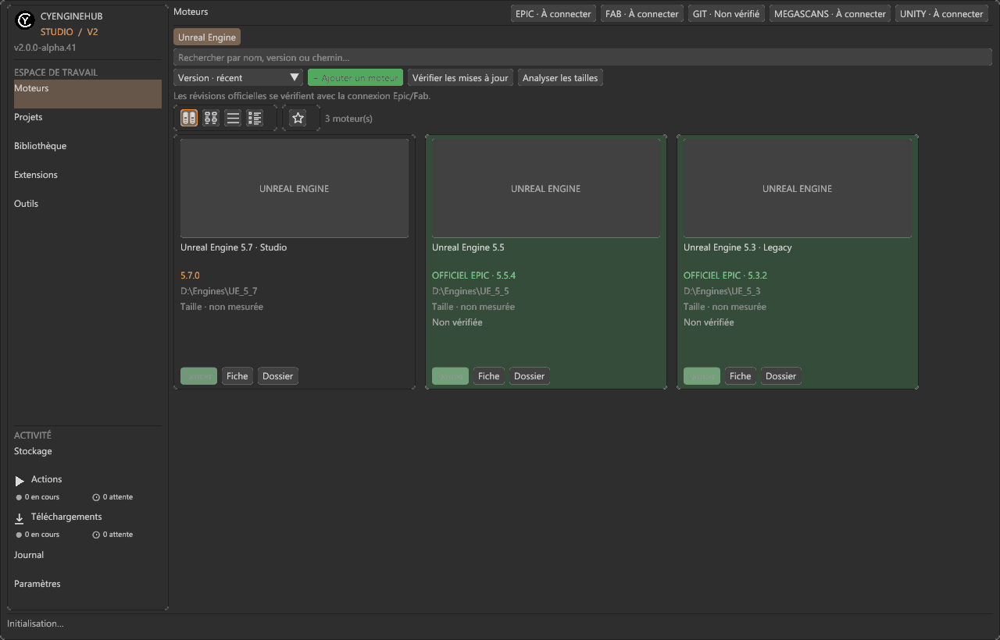
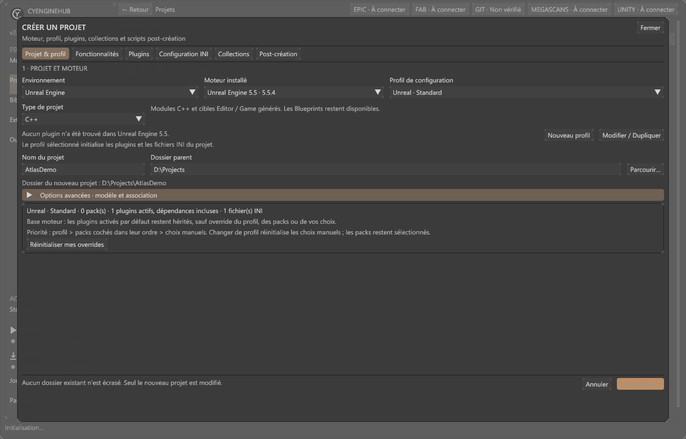
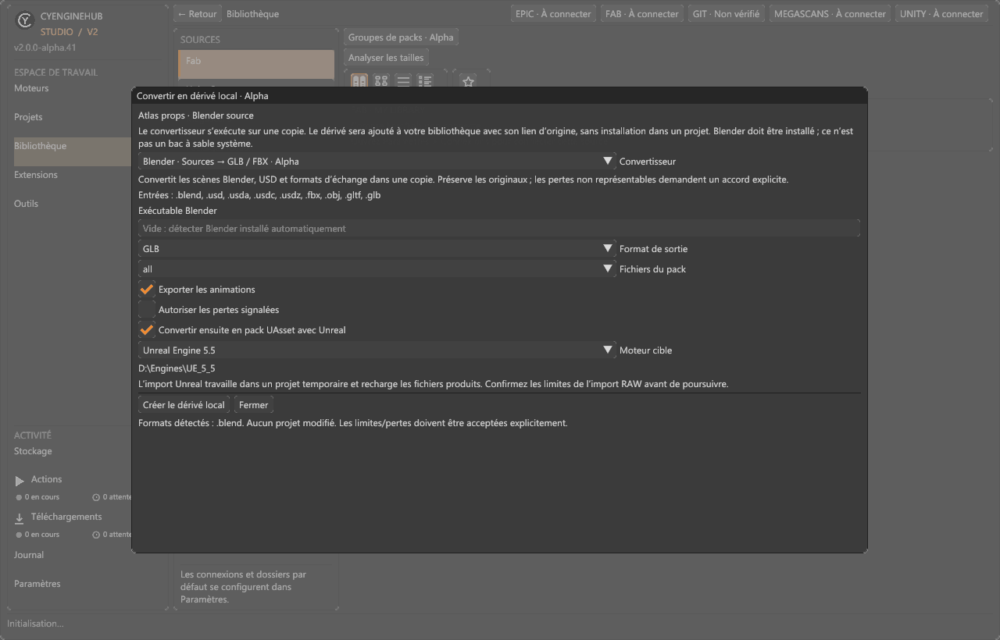

<table width="100%">
  <tr>
    <td width="300" align="left" valign="top">
      <a href="https://mrmybal.github.io/CyEngineHub/Documentation.html#/fr/welcome">Documentation</a><br>
      <a href="https://github.com/MrMybal/CyEngineHub">Dépôt des sources</a><br>
      <a href="https://github.com/MrMybal/CyEngineHub/issues">Suivi des problèmes</a><br><br>
      <sub>README</sub><br>
      <a href="README.md">English</a> · <a href="README.fr.md">Français</a>
    </td>
    <td width="400" align="center" valign="middle">
      
    </td>
    <td width="300" align="right" valign="top">
      <p><sub>Licence de l’application</sub><br><a href="LICENSE"><strong>GPL-3.0-only</strong></a></p>
      <p><sub>Version</sub><br><a href="docs/releases/v2.0.0-alpha.45.md"><strong>2.0.0-alpha.45</strong></a><br><strong>ALPHA</strong></p>
      <p><a href="https://github.com/MrMybal/CyEngineHub/releases/download/v2.0.0-alpha.45/CyEngineHub-2.0.0-alpha.45-Setup-win-x64.exe"><strong>Télécharger</strong></a><br><sub>Windows 10/11 x64</sub></p>
    </td>
  </tr>
</table>

<h1 align="center">CyEngineHub</h1>

Un hub de développement local pour gérer moteurs de jeu, projets et bibliothèques d’assets sous Windows. Unreal Engine bénéficie de l’intégration la plus poussée ; Unity, Godot et CRYENGINE disposent aussi de providers locaux. Organisez vos installations, préparez vos projets et installez les assets auxquels vous avez droit depuis une seule application.

> **ALPHA · 2.0.0-alpha.45**
>
> Une version expérimentale destinée aux essais et aux retours : certaines intégrations et conversions restent incomplètes. Cette version ajoute le lecteur d’aide CyDoc bilingue complet et des correctifs de patch moteur. Sauvegardez les projets avant installation, déplacement ou conversion. Consultez les [notes de version et limites connues](docs/releases/v2.0.0-alpha.45.md).

[](docs/screenshots/engines.png)

Les captures sont de véritables images non retouchées de la build de développement alpha.41, avec des données de démonstration fictives et aucun compte connecté. Elles peuvent différer de l’alpha.45. Cliquez sur une image pour l’afficher en taille réelle.

<a id="interface-officielle-v2"></a>

## À propos de CyEngineHub

Parcourez les moteurs et projets en cartes ou listes triables, recherchez et filtrez le catalogue, conservez des favoris et ouvrez une fiche au double-clic. L’interface par défaut utilise CyUI modulaire / Dear ImGui, avec thèmes et densité mémorisés ; Avalonia fournit les fenêtres natives, les surfaces graphiques et les sélecteurs de fichiers Windows. `--classic` reste un recours temporaire en cas de problème graphique.

Créez un projet Unreal Blueprint ou C++ avec un moteur identifié, un dossier de destination, un profil réutilisable, des plugins, des overrides INI et des scripts post-création. Les fiches projet donnent accès aux builds, aux diagnostics des toolchains et à la gestion des plugins. Actions suit les compilations, installations et analyses séparément de Téléchargements ; les transferts continuent pendant la navigation, avec concurrence réglable, annulation et reprise.

[](docs/screenshots/project-creation.png)

Fab et Megascans historique Quixel proposent catalogues liés au compte, collections, téléchargements et packages locaux. Cosmos, KitBash3D/Cargo, itch.io, BlenderKit/Blendkit, ArtStation, Gumroad et CGTrader ajoutent des plugins de marketplace avec accès web officiel, enregistrement des téléchargements terminés et bibliothèques/réglages propres. Ces connecteurs n’implémentent **pas** toutes les API d’inventaire des magasins et ne remplacent pas les clients officiels Cargo/BlenderKit lorsque ceux-ci sont nécessaires.

Inspectez une variante téléchargée, sélectionnez une méthode d’installation par cible ou préparez un dérivé local distinct. Les convertisseurs de sources peuvent exporter des scènes Blender en GLB/FBX et importer les sources prises en charge avec un moteur Unreal cible. Unreal Version Bridge emploie des adaptateurs natifs correspondants, pas un simple changement d’en-tête de version. Les originaux restent distincts des dérivés ; consultez les rapports de conversion et validez le résultat dans l’éditeur cible.

[](docs/screenshots/source-conversion.png)

<a id="fonctionnalités-de-cette-alpha"></a>

## Fonctionnalités

- **Moteurs** : détection, lancement, noms personnalisés, associations, informations Git, analyse de taille, téléchargements Unreal officiels et patchs explicitement confirmés. Le plan distingue transfert réseau, espace temporaire et variation de taille finale.
- **Projets** : création Blueprint/C++, profils éditables, packs de fonctionnalités, modèles de plugins, presets de build/packaging, journaux et diagnostic des prérequis.
- **Bibliothèques** : recherche, filtres, collections et groupes de packs ; compression par marketplace, quotas, bibliothèques ordonnées et emplacements séparés pour cache/téléchargements. Une installation de version locale peut réutiliser un package exploitable déjà présent.
- **Conversions** : chaînes de scripts configurables, dérivés locaux, extensions de conversion des sources et conversion expérimentale entre versions Unreal. La réparation optionnelle par agent CyToolsCore/MCP exige un consentement distinct pour l’exécution de code.
- **Client éditeur Unreal** : un plugin Alpha optionnel, installé séparément, propose recherche dans la bibliothèque possédée, installation additive dans le projet ouvert et progression des tâches. Les ZIP précompilés sont des [fichiers de release séparés](https://github.com/MrMybal/CyEngineHub/releases/tag/v2.0.0-alpha.45) ; une compatibilité exacte avec le build moteur est nécessaire.
- **Documentation intégrée** : Aide / F1 ouvre le même [lecteur HTML CyDoc](https://mrmybal.github.io/CyEngineHub/Documentation.html#/fr/welcome) que le site public : 25 chapitres utilisateur en anglais et français, références SDK publiques, recherche, images, galerie et schémas SVG.

<a id="limites-importantes"></a>

### Limites importantes

La conversion vers une ancienne version ne couvre pas universellement Blueprints, animation squelettique, World Partition ou plugins arbitraires. Un plugin exclusivement binaire ne peut pas être reciblé en changeant son libellé de version. Le bridge natif 5.7 → 5.5/5.3 possède un [périmètre validé documenté](docs/native-57-bridge-validation.md), pas une garantie pour tous les packs. Blender, les installations Unreal concernées et les autres convertisseurs externes s’installent séparément lorsqu’un parcours les nécessite.

L’accès aux marketplaces nécessite votre compte et vos droits sur les assets ; aucun connecteur ne contourne autorisations ou licences. Unity Asset Store n’a pas le même parcours distant complet que Fab. Les scripts d’installation et post-création doivent provenir de sources de confiance. Consultez les chapitres [conversion](https://mrmybal.github.io/CyEngineHub/Documentation.html#/fr/conversion) et [marketplaces](https://mrmybal.github.io/CyEngineHub/Documentation.html#/fr/connectors) pour les limites précises.

---

<a id="télécharger"></a>

## Installation

Les builds publiés ciblent **Windows 10/11 x64**. Le runtime .NET est inclus ; le SDK .NET sert uniquement à compiler les sources. L’hébergement du navigateur et de l’aide intégrés sous Windows utilise le runtime WebView2 de Microsoft, installé séparément. Les exécutables Alpha ne sont pas signés avec Authenticode : Windows peut afficher un avertissement.

1. [Téléchargez l’installateur Windows alpha.45](https://github.com/MrMybal/CyEngineHub/releases/download/v2.0.0-alpha.45/CyEngineHub-2.0.0-alpha.45-Setup-win-x64.exe), ou choisissez le [ZIP autonome](https://github.com/MrMybal/CyEngineHub/releases/download/v2.0.0-alpha.45/CyEngineHub-2.0.0-alpha.45-win-x64.zip).
2. Lancez l’installateur par utilisateur, sans droits administrateur. Pour le ZIP, extrayez **tous** les fichiers ensemble avant de lancer `CyEngineHub.Desktop.exe`.
3. Ouvrez l’application, vérifiez les moteurs/projets détectés et configurez les connexions et dossiers de bibliothèque nécessaires. L’ajout d’un compte marketplace reste optionnel.

Les [fichiers et empreintes de la release](https://github.com/MrMybal/CyEngineHub/releases/tag/v2.0.0-alpha.45) comprennent `SHA256SUMS.txt`. Le plugin éditeur est une installation optionnelle distincte ; suivez son [guide d’installation et de compatibilité](docs/unreal-editor-plugin.md).

Le manuel complet est livré dans `Documentation/` : ouvrez directement `Documentation/Documentation.html` avec ses ressources `DocData/`, ou utilisez Aide / F1. La lecture fonctionne en `file://`, sans serveur web, CDN ni compte. L’anglais est la langue par défaut ; le français est complet et sa sélection est indépendante de l’interface applicative partiellement traduite.

<a id="données-et-mises-à-jour"></a>

### Données et mises à jour

Réglages, catalogues et journaux sont placés par défaut dans `%LOCALAPPDATA%\CyEngineHub`. Configurez séparément les dossiers de packages/cache. Un fichier vide `portable.flag` à côté de l’exécutable active un dossier local `Data` ; conservez les deux lors des mises à jour manuelles par ZIP. L’installateur cible une installation par utilisateur, pas un dossier portable. Installation et désinstallation ne suppriment pas les bibliothèques ou projets.

L’application recherche les releases GitHub officielles au démarrage et propose les mises à jour disponibles. Paramètres → Avancé → Mises à jour permet de régler les vérifications au lancement et les préversions ; le canal Alpha/Bêta est activé par défaut pour cette Alpha. Les mises à jour téléchargées sont vérifiées avant fermeture de l’application et lancement de l’installateur. La connexion Epic/Fab propose une fenêtre intégrée et un [mode manuel par navigateur externe](docs/fab-login.md) ; les catalogues déjà en cache restent consultables hors ligne.

<a id="compiler-et-tester"></a>

## Sources, compilation et bibliothèques nécessaires

<details>
<summary>Compiler l’application Windows et sa documentation hors ligne</summary>

Prérequis : SDK .NET **9.0.306** (ou un correctif autorisé par `global.json`), Git, CMake 3.21+, outils C++ Visual Studio 2022/SDK Windows et Node.js **22+** avec npm pour générer la documentation. L’application cible .NET 8. L’accès aux sources CyUI/CyDoc épinglées est nécessaire ; utilisez l’authentification Git habituelle de votre machine.

```powershell
git clone https://github.com/MrMybal/CyEngineHub.git
cd CyEngineHub
dotnet restore .\CyEngineHub.sln
.\tools\ui\build-cyui-native.ps1
dotnet build .\CyEngineHub.sln -c Release
dotnet test .\CyEngineHub.sln -c Release
dotnet run --project .\src\CyEngineHub.Desktop\CyEngineHub.Desktop.csproj
```

La compilation native utilise les révisions de `native/CyEngineHub.CyUI/dependencies.lock.json`. Ne substituez pas une DLL ImGui sans rapport. La compilation du bureau génère et copie automatiquement l’export CyDoc complet ; pour le régénérer et le vérifier explicitement :

```powershell
.\.CyDocBuild\build.ps1 -Check
npm test --prefix .CyDocBuild
```

Seuls les modules image et gallery du lecteur sont sélectionnés. Les schémas SVG statiques n’exigent pas le module graph, et le lecteur n’embarque pas Three.js. Node.js et le compilateur documentaire servent à la génération, pas à la lecture du manuel installé.

Le packaging Windows nécessite aussi Inno Setup 7 et des adaptateurs de conversion natifs correspondants, contrôlés pour la confidentialité. `tools/release/build-windows.ps1` exécute les tests, prépare les exécutables autonomes et la documentation, contrôle le paquet et produit installateur, ZIP et empreintes ; il ne les publie pas. Voir le [guide de compilation de l’interface native](docs/cyui-migration.md) et le [parcours de publication](docs/application-updates.md). Les adaptateurs Unreal et le client éditeur ont leurs propres prérequis de compilation liés au moteur.

</details>

---

## Licence

Le code propre à CyEngineHub, les scripts intégrés et sa documentation sont sous **[GPLv3 uniquement](LICENSE)**. Le code original du [client éditeur Unreal](extensions/unreal/CyEngineHub/LICENSE) et de l’[adaptateur natif de conversion](extensions/builtin/cyenginehub.unreal-version-bridge/native-source/CyHubNativeBridge/LICENSE) est séparément sous **MIT**. Consultez le [périmètre exact des licences](LICENSING.md) ; cela ne change pas les conditions d’Unreal Engine, des assets marketplace ou des dépendances.

### Application et composants d’exécution optionnels

| Bibliothèque · sources | Licence · texte | Utilisation / périmètre |
| --- | --- | --- |
| [Avalonia 12.1.1](https://github.com/AvaloniaUI/Avalonia) | [MIT](https://licenses.nuget.org/MIT) et notices des packages | Fenêtres natives, rendu, dialogues et interface classique de secours. |
| [CyUI 1.2.0](https://github.com/MrMybal/CyUI) | [MIT](LICENCES/CyUI/LICENSE) | Modules d’interface native épinglés ; les composants Lexilla/Scintilla/SciTE conservent [leurs notices](LICENCES/CyUI/THIRD_PARTY_NOTICES.md). |
| [Dear ImGui 1.92.1](https://github.com/ocornut/imgui) / [cimgui](https://github.com/JunaMeinhold/cimgui) | [MIT](LICENCES/DearImGui/LICENSE.txt) / [MIT](LICENCES/cimgui/LICENSE) | Contrôles natifs et bridge C ABI de l’application. |
| [Hexa.NET.ImGui 2.2.8.5](https://github.com/HexaEngine/Hexa.NET.ImGui) / [HexaGen.Runtime](https://github.com/HexaEngine/HexaGen) | [MIT](LICENCES/Hexa.NET.ImGui/LICENSE.txt) / [MIT](LICENCES/HexaGen.Runtime/LICENSE.txt) | Liaisons .NET/natives. |
| [Silk.NET.OpenGLES 2.23.0](https://github.com/dotnet/Silk.NET) | [MIT](https://licenses.nuget.org/MIT) | Liaisons OpenGL ES pour le rendu. |
| [Microsoft.Data.Sqlite 8.0.30](https://github.com/dotnet/efcore) | [MIT](https://licenses.nuget.org/MIT) et notices des composants natifs | Accès aux données locales ; conserver les notices SQLite et des autres packages transitifs. |
| [SDK Microsoft WebView2](https://www.nuget.org/packages/Microsoft.Web.WebView2/1.0.4191.47) | [Conditions Microsoft](THIRD_PARTY_NOTICES.md#microsoft-edge-webview2) | Connexion intégrée, pages marketplace et aide hors ligne sous Windows ; runtime navigateur installé séparément. |
| [Runtime .NET 8](https://github.com/dotnet/runtime) | [MIT et notices des composants](https://github.com/dotnet/runtime/blob/main/LICENSE.TXT) | Runtime inclus dans la distribution Windows. |
| [CyDoc 0.1.0](https://github.com/MrMybal/CyDoc) | [MIT](https://github.com/MrMybal/CyDoc/blob/6ddf9a582defb2f11fbb3f992afef6f98dcadc93/LICENSE) | Lecteur hors ligne avec modules image/gallery ; licence complète dans `Documentation/DocData/`. |
| [egs-api-rs](https://github.com/AchetaGames/egs-api-rs) | [MIT](THIRD_PARTY_NOTICES.md#egs-api-rs) | Code adapté pour les manifests/chunks Epic et la compatibilité Fab. |
| [CyToolsCore 0.10.1](https://github.com/MrMybal/CyToolsCore) / [MCP Python SDK 1.30.0](https://github.com/modelcontextprotocol/python-sdk) | [MIT](LICENCES/CyToolsCore-MIT.txt) / [MIT](https://github.com/modelcontextprotocol/python-sdk/blob/main/LICENSE) | Compagnon Python optionnel pour la réparation par agent ; dépendances installées seulement sur configuration explicite. |

### Génération documentaire et tests

| Bibliothèque · sources | Licence · texte | Utilisation / périmètre |
| --- | --- | --- |
| [marked](https://github.com/markedjs/marked), [PrismJS](https://github.com/PrismJS/prism), [esbuild](https://github.com/evanw/esbuild) | [MIT](https://licenses.nuget.org/MIT) | Compilation Markdown, coloration et assemblage lors de la génération ; pas des runtimes du lecteur installé. |
| [Happy DOM 21.0.4](https://github.com/capricorn86/happy-dom) | [MIT](https://licenses.nuget.org/MIT) | Tests DOM de documentation uniquement. |
| [xUnit](https://github.com/xunit/xunit) / [VSTest](https://github.com/microsoft/vstest) | [Apache-2.0](https://licenses.nuget.org/Apache-2.0) / [MIT](https://licenses.nuget.org/MIT) | Tests .NET uniquement. |

Ces tableaux indexent les composants principaux ; ils ne constituent ni les notices transitives exhaustives ni une conclusion juridique de compatibilité. Conservez [THIRD_PARTY_NOTICES.md](THIRD_PARTY_NOTICES.md), `LICENCES/`, les métadonnées des packages et le dossier `Licenses/` de la distribution. Les moteurs externes, Blender, les formats sources propriétaires et les marketplaces gardent leurs conditions propres.

<a id="documentation"></a>

## Références et liens

- [Documentation française](https://mrmybal.github.io/CyEngineHub/Documentation.html#/fr/welcome) · [Documentation anglaise](https://mrmybal.github.io/CyEngineHub/Documentation.html#/en/welcome) — le véritable lecteur HTML, également livré hors ligne.
- [Dépôt des sources](https://github.com/MrMybal/CyEngineHub) · [Releases](https://github.com/MrMybal/CyEngineHub/releases) · [Suivi des problèmes](https://github.com/MrMybal/CyEngineHub/issues).
- [Notes alpha.45](docs/releases/v2.0.0-alpha.45.md) · [Périmètre des licences](LICENSING.md).
- Références développeur : [architecture](docs/architecture.md), [SDK d’extensions](docs/extensions.md), [convertisseurs de sources](docs/source-converters.md), [configuration MCP optionnelle](extensions/builtin/cyenginehub.unreal-version-bridge/mcp/README.md).

<a id="optional-megascans-catalog-access"></a>

La recherche optionnelle dans le catalogue Megascans nécessite une clé autorisée configurée localement : voir la [configuration du catalogue](docs/quixel-local-configuration.md). CyEngineHub est indépendant d’Epic Games, Quixel, Unity et des autres éditeurs mentionnés.
