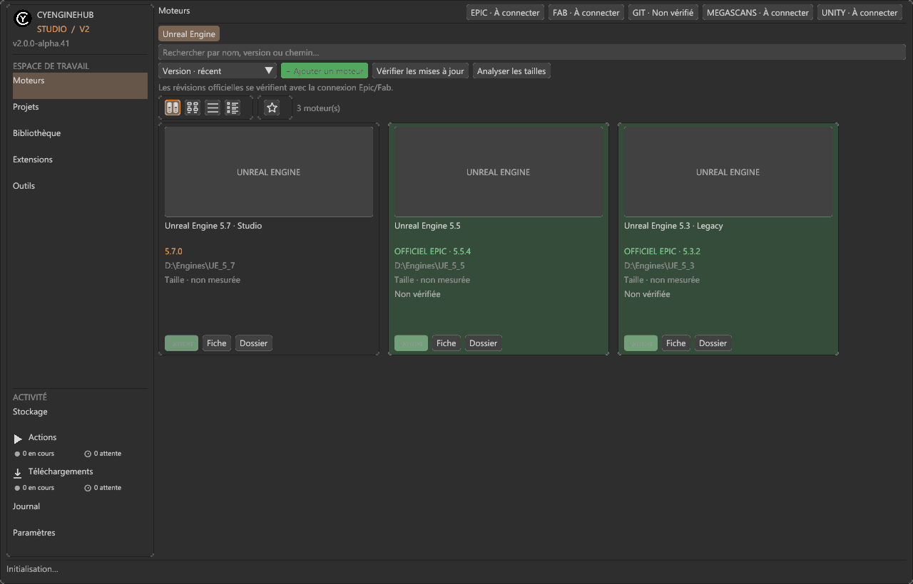
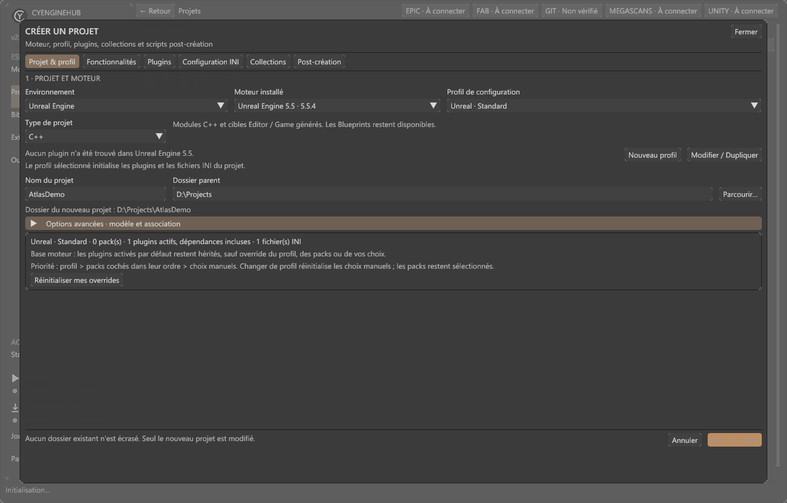
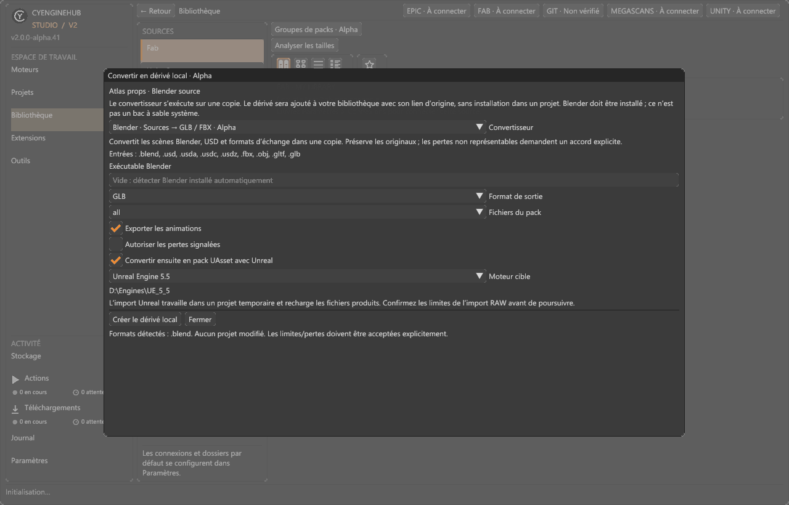

<table width="100%">
  <tr>
    <td width="300" align="left" valign="top">
      <a href="https://mrmybal.github.io/CyEngineHub/Documentation.html#/en/welcome">Documentation</a><br>
      <a href="https://mrmybal.github.io/CyEngineHub/showcase/?lang=en">Showcase</a><br>
      <a href="https://github.com/MrMybal/CyEngineHub">Source repository</a><br>
      <a href="https://github.com/MrMybal/CyEngineHub/issues">Issue tracker</a><br><br>
      <sub>README</sub><br>
      <a href="README.md">English</a> · <a href="README.fr.md">Français</a>
    </td>
    <td width="400" align="center" valign="middle">
      
    </td>
    <td width="300" align="right" valign="top">
      <p><sub>Application license</sub><br><a href="LICENSE"><strong>GPL-3.0-only</strong></a></p>
      <p><sub>Version</sub><br><a href="docs/releases/v2.0.0-alpha.45.en.md"><strong>2.0.0-alpha.45</strong></a><br><strong>ALPHA</strong></p>
      <p><a href="https://github.com/MrMybal/CyEngineHub/releases/download/v2.0.0-alpha.45/CyEngineHub-2.0.0-alpha.45-Setup-win-x64.exe"><strong>Download</strong></a><br><sub>Windows 10/11 x64</sub></p>
    </td>
  </tr>
</table>

<h1 align="center">CyEngineHub</h1>

A local-first development hub for managing game engines, projects and asset libraries on Windows. Unreal Engine has the deepest integration; Unity, Godot and CRYENGINE also have local providers. Organize your installations, prepare projects and install assets you are entitled to use from one application.

> **ALPHA · 2.0.0-alpha.45**
>
> An experimental release for testing and feedback: some integrations and conversions remain incomplete. This version adds the complete bilingual CyDoc help reader and engine-patch fixes. Back up projects before installation, movement or conversion operations. Read the [version notes and known limitations](docs/releases/v2.0.0-alpha.45.en.md).

[](docs/screenshots/engines.png)

The screenshots are real, unretouched captures of the alpha.41 development build with fictional demo data and no connected accounts. They may differ from alpha.45. Click an image to view it at full size.

<a id="interface-officielle-v2"></a>
<a id="official-v2-interface"></a>

## About CyEngineHub

Browse engines and projects as cards or sortable lists, search and filter the catalog, keep favorites and open a detail page with a double-click. The default interface uses modular CyUI / Dear ImGui, with saved themes and density preferences; Avalonia supplies native windows, graphics surfaces and Windows file pickers. `--classic` remains a temporary fallback for graphics problems.

Create an Unreal Blueprint or C++ project with a named engine, destination folder, reusable profile, plugins, INI overrides and post-creation scripts. Project sheets lead to builds, toolchain diagnostics and plugin management. Actions tracks builds, installations and analyses separately from Downloads; transfers continue during navigation, with configurable concurrency, cancellation and resume.

[](docs/screenshots/project-creation.png)

Fab and legacy Quixel Megascans offer account-based catalogs, collections, downloads and local packages. Cosmos, KitBash3D/Cargo, itch.io, BlenderKit/Blendkit, ArtStation, Gumroad and CGTrader add marketplace plugins with official web access, completed-download registration and their own local libraries/settings. These connectors do **not** implement every store's inventory API or replace the official Cargo/BlenderKit clients where those are required.

Inspect a downloaded variant, select an installation method for each target, or prepare a separate local derivative. Source converters can export Blender scenes to GLB/FBX and optionally import supported sources with a target Unreal engine. Unreal Version Bridge uses matching native adapters rather than simply changing version headers. Originals remain separate from derivatives; review conversion reports and validate the result in the target editor.

[](docs/screenshots/source-conversion.png)

<a id="fonctionnalités-de-cette-alpha"></a>
<a id="features-in-this-alpha"></a>

## Features

- **Engines:** discovery, launch, custom names, associations, Git details, size analysis, official Unreal downloads and explicitly confirmed patch updates. Patch planning separates network transfer, temporary space and final size changes.
- **Projects:** Blueprint/C++ creation, editable profiles, feature packs, plugin templates, build/packaging presets, logs and prerequisite diagnostics.
- **Libraries:** search, filters, collections and pack groups; per-marketplace compression, quotas, ordered libraries and separate cache/download locations. Local-version installation can reuse a usable package already on disk.
- **Conversions:** configurable script chains, local derivatives, source-converter extensions and experimental Unreal version conversion. Optional CyToolsCore/MCP agent repair requires separate consent for code execution.
- **Unreal Editor client:** an optional, separately installed Alpha plugin provides owned-library search, additive installation into the open project and task progress. Precompiled ZIPs are separate [release assets](https://github.com/MrMybal/CyEngineHub/releases/tag/v2.0.0-alpha.45); exact engine-build compatibility is required.
- **Integrated documentation:** Help / F1 opens the same [CyDoc HTML reader](https://mrmybal.github.io/CyEngineHub/Documentation.html#/en/welcome) as the public site: 25 user chapters in English and French, public SDK references, search, images, a gallery and SVG diagrams.

<a id="limites-importantes"></a>
<a id="important-limitations"></a>

### Important limits

Older-version conversion is not universal support for Blueprints, skeletal animation, World Partition or arbitrary plugins. Binary-only plugins cannot be retargeted by changing a version label. The native 5.7 → 5.5/5.3 bridge has a [documented validated scope](docs/native-57-bridge-validation.md), not a promise of compatibility with every pack. Blender, relevant Unreal installations and other external converters must be installed separately when a workflow needs them.

Marketplace access requires your account and asset rights; no connector bypasses provider permissions or licenses. Unity Asset Store does not have the same complete remote workflow as Fab. Installation and post-creation scripts must come from trusted sources. See the [conversion](https://mrmybal.github.io/CyEngineHub/Documentation.html#/en/conversion) and [marketplace](https://mrmybal.github.io/CyEngineHub/Documentation.html#/en/connectors) chapters for specific limits.

---

<a id="télécharger"></a>
<a id="download"></a>

## Installation

Published builds target **Windows 10/11 x64**. They include the .NET runtime; the .NET SDK is only needed to build from source. The Windows embedded browser/help host uses Microsoft's separately installed WebView2 Runtime. The Alpha executables are not Authenticode-signed, so Windows may display a warning.

1. [Download the alpha.45 Windows installer](https://github.com/MrMybal/CyEngineHub/releases/download/v2.0.0-alpha.45/CyEngineHub-2.0.0-alpha.45-Setup-win-x64.exe), or choose the [self-contained ZIP](https://github.com/MrMybal/CyEngineHub/releases/download/v2.0.0-alpha.45/CyEngineHub-2.0.0-alpha.45-win-x64.zip).
2. Run the per-user installer without administrator rights. For the ZIP, extract **all** files together before running `CyEngineHub.Desktop.exe`.
3. Open the application, review detected engines/projects and configure the connections and library folders you need. Adding a marketplace account remains optional.

[Release assets and checksums](https://github.com/MrMybal/CyEngineHub/releases/tag/v2.0.0-alpha.45) include `SHA256SUMS.txt`. The editor plugin is an optional, separate installation; follow its [setup and compatibility guide](docs/unreal-editor-plugin.md).

The complete manual ships in `Documentation/`: open `Documentation/Documentation.html` directly with its `DocData/` resources, or use Help / F1. Reading works through `file://`, without a web server, CDN or account. English is the default; French is complete and its selection is independent of the partially translated application UI.

<a id="données-et-mises-à-jour"></a>

### Data and updates

Settings, catalogs and logs default to `%LOCALAPPDATA%\CyEngineHub`. Configure package/cache folders separately. An empty `portable.flag` beside the executable selects a local `Data` directory; preserve both during manual ZIP updates. The installer targets a per-user installation, not a portable directory. Installation/uninstallation does not delete libraries or projects.

The application checks official GitHub releases at startup and proposes available updates. Settings → Advanced → Updates controls startup checks and prereleases; the Alpha/Beta channel is enabled by default for this Alpha. Downloaded updates are verified before the application closes and launches the installer. Epic/Fab sign-in supports an embedded window and a [manual external-browser mode](docs/fab-login.md); offline catalogs remain available where already cached.

<a id="compiler-et-tester"></a>
<a id="build-and-test"></a>

## Source, build and required libraries

<details>
<summary>Build the Windows application and its offline documentation</summary>

Requirements: .NET SDK **9.0.306** (or a patch allowed by `global.json`), Git, CMake 3.21+, Visual Studio 2022 C++ tools/Windows SDK, and Node.js **22+** with npm for documentation generation. The application targets .NET 8. Access to the pinned CyUI/CyDoc sources is required; use the normal Git authentication available on your machine.

```powershell
git clone https://github.com/MrMybal/CyEngineHub.git
cd CyEngineHub
dotnet restore .\CyEngineHub.sln
.\tools\ui\build-cyui-native.ps1
dotnet build .\CyEngineHub.sln -c Release
dotnet test .\CyEngineHub.sln -c Release
dotnet run --project .\src\CyEngineHub.Desktop\CyEngineHub.Desktop.csproj
```

The native build uses the revisions in `native/CyEngineHub.CyUI/dependencies.lock.json`. Do not substitute an unrelated ImGui DLL. The desktop build generates and copies the full CyDoc export automatically; regenerate/check it explicitly with:

```powershell
.\.CyDocBuild\build.ps1 -Check
npm test --prefix .CyDocBuild
```

Only the image and gallery reader modules are selected. Static SVG diagrams need no graph module, and the reader does not bundle Three.js. Node.js and the documentation compiler are build tools, not requirements for reading the installed manual.

Build the bilingual visual showcase, including a complete local copy of the same manual:

```powershell
node website/build.mjs
node website/preview.mjs --port 4789 --base /showcase/
```

Open `http://127.0.0.1:4789/showcase/`, or open the generated `dist/website/index.html` directly. The [showcase build and verification guide](website/README.md) explains local use; these commands do not publish or deploy anything.

Windows packaging additionally needs Inno Setup 7 and matching, privacy-checked native conversion adapters. `tools/release/build-windows.ps1` runs tests, stages self-contained executables and documentation, checks the package, and creates the installer, ZIP and hashes; it does not publish them. See the [native UI build guide](docs/cyui-migration.md) and [release workflow](docs/application-updates.md). Unreal adapters and the editor client have separate engine-specific build requirements.

</details>

---

## License

CyEngineHub's own source, bundled scripts and documentation use **[GPLv3 only](LICENSE)**. The original [Unreal Editor client](extensions/unreal/CyEngineHub/LICENSE) and [native conversion adapter](extensions/builtin/cyenginehub.unreal-version-bridge/native-source/CyHubNativeBridge/LICENSE) are separately **MIT** licensed. See the exact [licensing scope](LICENSING.md); this does not relicense Unreal Engine, marketplace assets or dependencies.

### Application and optional runtime components

| Library · source | License · terms | Use / scope |
| --- | --- | --- |
| [Avalonia 12.1.1](https://github.com/AvaloniaUI/Avalonia) | [MIT](https://licenses.nuget.org/MIT) and package notices | Native windows, rendering, dialogs and the classic fallback. |
| [CyUI 1.2.0](https://github.com/MrMybal/CyUI) | [MIT](LICENCES/CyUI/LICENSE) | Pinned native UI modules; bundled Lexilla/Scintilla/SciTE components retain [their notices](LICENCES/CyUI/THIRD_PARTY_NOTICES.md). |
| [Dear ImGui 1.92.1](https://github.com/ocornut/imgui) / [cimgui](https://github.com/JunaMeinhold/cimgui) | [MIT](LICENCES/DearImGui/LICENSE.txt) / [MIT](LICENCES/cimgui/LICENSE) | Native controls and the application's C ABI bridge. |
| [Hexa.NET.ImGui 2.2.8.5](https://github.com/HexaEngine/Hexa.NET.ImGui) / [HexaGen.Runtime](https://github.com/HexaEngine/HexaGen) | [MIT](LICENCES/Hexa.NET.ImGui/LICENSE.txt) / [MIT](LICENCES/HexaGen.Runtime/LICENSE.txt) | .NET/native bindings. |
| [Silk.NET.OpenGLES 2.23.0](https://github.com/dotnet/Silk.NET) | [MIT](https://licenses.nuget.org/MIT) | OpenGL ES bindings for rendering. |
| [Microsoft.Data.Sqlite 8.0.30](https://github.com/dotnet/efcore) | [MIT](https://licenses.nuget.org/MIT) and native-component notices | Local data access; retain SQLite and other transitive package notices. |
| [Microsoft WebView2 SDK](https://www.nuget.org/packages/Microsoft.Web.WebView2/1.0.4191.47) | [Microsoft terms](THIRD_PARTY_NOTICES.md#microsoft-edge-webview2) | Windows embedded sign-in, marketplace pages and offline help; the browser runtime is separately installed. |
| [.NET 8 runtime](https://github.com/dotnet/runtime) | [MIT and component notices](https://github.com/dotnet/runtime/blob/main/LICENSE.TXT) | Runtime included in the Windows distribution. |
| [CyDoc 0.1.0](https://github.com/MrMybal/CyDoc) | [MIT](https://github.com/MrMybal/CyDoc/blob/6ddf9a582defb2f11fbb3f992afef6f98dcadc93/LICENSE) | Offline reader with image/gallery modules; its full license ships in `Documentation/DocData/`. |
| [egs-api-rs](https://github.com/AchetaGames/egs-api-rs) | [MIT](THIRD_PARTY_NOTICES.md#egs-api-rs) | Adapted Epic manifest/chunk and Fab compatibility code. |
| [CyToolsCore 0.10.1](https://github.com/MrMybal/CyToolsCore) / [MCP Python SDK 1.30.0](https://github.com/modelcontextprotocol/python-sdk) | [MIT](LICENCES/CyToolsCore-MIT.txt) / [MIT](https://github.com/modelcontextprotocol/python-sdk/blob/main/LICENSE) | Optional Python agent-repair companion; dependencies install only through explicit setup. |

### Documentation build and tests

| Library · source | License · terms | Use / scope |
| --- | --- | --- |
| [marked](https://github.com/markedjs/marked), [PrismJS](https://github.com/PrismJS/prism), [esbuild](https://github.com/evanw/esbuild) | [MIT](https://licenses.nuget.org/MIT) | Build-time Markdown compilation, highlighting and bundling; not installed-reader runtimes. |
| [Happy DOM 21.0.4](https://github.com/capricorn86/happy-dom) | [MIT](https://licenses.nuget.org/MIT) | Documentation DOM tests only. |
| [xUnit](https://github.com/xunit/xunit) / [VSTest](https://github.com/microsoft/vstest) | [Apache-2.0](https://licenses.nuget.org/Apache-2.0) / [MIT](https://licenses.nuget.org/MIT) | .NET tests only. |

These tables index the main components; they are not exhaustive transitive notices or a legal compatibility determination. Retain [THIRD_PARTY_NOTICES.md](THIRD_PARTY_NOTICES.md), `LICENCES/`, package metadata and the distribution's `Licenses/` directory. External engines, Blender, proprietary source formats and asset marketplaces retain their own terms.

<a id="documentation"></a>

## References and links

- [English documentation](https://mrmybal.github.io/CyEngineHub/Documentation.html#/en/welcome) · [French documentation](https://mrmybal.github.io/CyEngineHub/Documentation.html#/fr/welcome) — the actual HTML reader, also bundled offline.
- [Source repository](https://github.com/MrMybal/CyEngineHub) · [Releases](https://github.com/MrMybal/CyEngineHub/releases) · [Issue tracker](https://github.com/MrMybal/CyEngineHub/issues).
- [alpha.45 notes](docs/releases/v2.0.0-alpha.45.en.md) · [Licensing scope](LICENSING.md).
- Developer references: [architecture](docs/architecture.md), [extension SDK](docs/extensions.md), [source converters](docs/source-converters.md), [optional MCP setup](extensions/builtin/cyenginehub.unreal-version-bridge/mcp/README.md).

<a id="optional-megascans-catalog-access"></a>

Optional Megascans catalog search needs an authorized, locally configured key: see [catalog configuration](docs/quixel-local-configuration.md). CyEngineHub is independent of Epic Games, Quixel, Unity and the other publishers mentioned.
